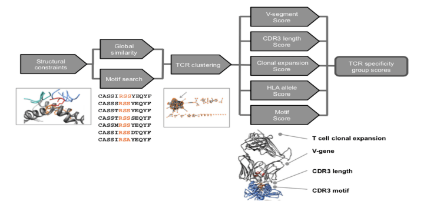

[Uri Laserson](http://lasersonlab.org/) organized a delightful class at Mount Sinai called [Applications of DNA Sequencing and Synthesis to Immunology](http://bit.ly/SeqImm-2018). It was a survey of several related emerging trends in genomics and immunology with each week was structured around a pair of papers presented by students. For the first week, I presented [Identifying specificity groups in the T cell receptor repertoire](https://www.ncbi.nlm.nih.gov/pmc/articles/PMC5794212/) (a.k.a. "the GLIPH paper") by [Jake Glanville](https://twitter.com/curlyjunglejake), [Mark Davis](http://med.stanford.edu/davislab.html) (and many other people).

The basic gist of GLIPH (*Grouping of Lymphocyte Interactions by Paratope Hotspots)* is that since [TCR](https://en.wikipedia.org/wiki/T-cell_receptor)s with similar antigen specificity have been observed to have similar CDR3 sequences then clustering TCRs in the space of amino acid sequences will also effectively cluster them by specificity. The GLIPH algorithm links two TCRs into a cluster by either of the following heuristics:

- *global*: nearly identical sequences (differing by only 1 amino acid)
- *local*: sharing distinctive k-mers (for k=2,3,4) in the region of the TCR most likely to contact the peptide, where distinctiveness is defined as being comparatively rare in a reference population of naive T-cells

In addition to these linkage criteria, GLIPH also uses a variety of features to score the quality/purity of each cluster. The complete algorithm schematic is given in Extended Data Figure 3:

One of the main evaluations of GLIPH is summarized in Extended Data Figure 4c:

**Data:** The authors created a dataset of TCRs with known antigen specificity by collecting blood samples from 33 healthy donors and sorting their T-cells using 8 pMHC [tetramers](http://www.tcells.org/scientific/pMHC/pMHCtetramers/) containing known [immunodominant](https://en.wikipedia.org/wiki/Immunodominance) epitopes from CMV, EBV and flu. The sequenced TCRs of these antigen specific T-cells can then be used as inputs to any clustering approach and the specificity labels can be used to evaluate the purity of generated clusters.

**Sensitivity vs. Purity:** In the above figure, each dot represents a different clustering algorithm. The X-axis is the sensitivity of the clustering (what fraction of TCRs are assigned to clusters) and Y-axis is the average purity of each cluster (where 100% means that any linked TCRs always share antigen specificity). The two linkage criteria used by GLIPH are "local +struct" and "global dist=1". The label "+struct" just means that the comparison of k-mers occurs only in the [CDR3](https://en.wikipedia.org/wiki/Complementarity-determining_region) region of the TCR, rather than the whole sequence. As you can see, both of these clustering rules perform almost as well as the GLIPH algorithm itself.

**Pruning after clustering?** I think GLIPH performs some kind of filtering on low quality clusters which was either unstated or I simply missed in my reading of the paper). If we were to simply link TCRs which satisfy either one of the independent "local +struct" and "global dist=1" criteria we would expect to see an increase on the X-axis to at least the ~15% achieved by "global dist=1" clustering and likely to an even higher sensitivity (20% or beyond). This sensitivity would most likely be accompanied by a decrease in cluster purity, due to spurious TCR linkages. To achieve a lower sensitivity and higher cluster purity requires the elimination of some cluster linkages. Maybe this final pruning step is obvious from the source code but reading Perl has never come easily to me.

**Broader applications?** Since all of the approaches discussed in the GLIPH paper are different approaches to unsupervised clustering, they rely on generating relatively "pure" clusters for reasoning about the specificity of TCRs with unknown function. While the linkage method presented might achieve tolerable cluster purities when the labels are restricted to 8 known epitopes, I wonder how well this approach scales in the presence of additional labels. If a high throughput tetramer assay were used to identify TCR specificities across hundreds or thousands of epitopes, would all the clusters be hopelessly impure?
